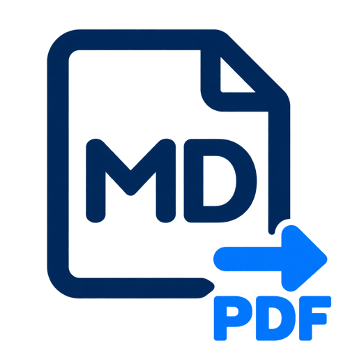

<p align="center">
  
</p>

# Markdown to PDF

**A VS Code extension to preview and export Markdown as PDF — entirely on your computer.**


[](LICENSE)

**[Install in VS Code](#build-and-install-from-source)** · [繁體中文](README.zh-TW.md) · [Development guide](CONTRIBUTING.md) · [Acceptance checklist](ACCEPTANCE.md)

Syntax-highlighted code, math, Mermaid diagrams, and English / Traditional Chinese typography. Install from a VSIX; not yet published on the Marketplace.


## How it works

1. Right-click inside a Markdown editor → **Markdown: Export to PDF**.
2. Review the PDF preview inside VS Code.
3. Click **Confirm and Export**, then choose the filename and folder.


Screenshots use VS Code’s **Quiet Light** theme with Chat hidden. The PDF uses its own styles, independently of your editor theme.

## Features

- Preview the exact PDF that will be saved, including unsaved editor changes.
- Syntax highlighting with **One Light** (default) or **GitHub Dark** code blocks.
- Tables, local images, KaTeX math, Mermaid diagrams, and GitHub-style alerts.
- English and Traditional Chinese with bundled fonts.
- A4 pages with page numbers, wrapped code, and repeating table headers.
- Local rendering with bundled Chromium; no installed Chrome, cloud conversion, or first-export downloads.

## Platforms

| Platform                          | VSIX suffix    | Validation status                         |
| --------------------------------- | -------------- | ----------------------------------------- |
| macOS, Apple Silicon              | `darwin-arm64` | Local rendering and preview checks passed |
| macOS, Intel                      | `darwin-x64`   | Native validation pending                 |
| Windows 11, x64                   | `win32-x64`    | Native validation pending                 |
| Ubuntu 22.04 / 24.04 desktop, x64 | `linux-x64`    | Native validation pending                 |

Cross-platform build automation is included; this does not mean every platform has passed acceptance. See [the checklist](ACCEPTANCE.md). Windows ARM, other Linux distributions, VS Code for the Web, and remote workspaces are outside the validated scope.

**Ubuntu:** Chromium’s system libraries must be installed before going offline. They are not bundled in the VSIX. See [Linux preparation](CONTRIBUTING.md#linux-preparation). A clean or minimal Ubuntu installation may need administrator setup.

## Build and install from source

Prerequisites: **Git**, **Node.js 24 with npm**, and **VS Code 1.95 or newer**. Build on the operating system and architecture where you will use the extension. Internet access is needed to download build dependencies and Chromium; export runs locally afterward.

### 1. Clone and install dependencies

Clone the repository and enter the project folder:

```sh
git clone https://github.com/maggie62755/markdown-to-pdf.git
cd markdown-to-pdf
npm ci
npm run prepare:browser
```

### 2. Prepare Ubuntu system libraries (Ubuntu only)

Skip this step on macOS and Windows. On Ubuntu, run this before building the VSIX; it may require administrator privileges:

```sh
node node_modules/playwright-core/cli.js install-deps chromium
```

If you install the resulting VSIX on another Ubuntu machine, that machine also needs the system libraries provisioned before offline use.

### 3. Build the installable VSIX

```sh
npm run package
```

This command builds the extension, bundles local resources, checks that Chromium starts, and creates a VSIX in the project root. You do not need to run `npm run build` separately; that command alone does not create an installable VSIX.

| Build machine       | Generated file                      |
| ------------------- | ----------------------------------- |
| macOS Apple Silicon | `markdown-to-pdf-darwin-arm64.vsix` |
| macOS Intel         | `markdown-to-pdf-darwin-x64.vsix`   |
| Windows x64         | `markdown-to-pdf-win32-x64.vsix`    |
| Ubuntu x64          | `markdown-to-pdf-linux-x64.vsix`    |

### 4. Install in VS Code

If you installed the earlier **Local Markdown PDF** extension, uninstall it before installing **Markdown to PDF**. The package identifier has changed, so VS Code treats it as a separate extension. The existing `localMarkdownPdf` command and setting IDs are retained.

1. Open VS Code and press **Cmd+Shift+P** on macOS or **Ctrl+Shift+P** on Windows/Linux.
2. Run **Extensions: Install from VSIX…**.
3. Select the generated `.vsix` file from the project folder.
4. If VS Code prompts you to reload, reload the window.
5. Open `fixtures/quick-start.md`, right-click inside the editor, and choose **Markdown: Export to PDF** to try the preview and export flow.

Alternatively, if the `code` command is available in your terminal, install the file directly. For example, on an Apple Silicon Mac:

```sh
code --install-extension ./markdown-to-pdf-darwin-arm64.vsix
```

Use the filename from the table for your platform. If `code` is not found, use the VS Code menu steps above. After changing the source, run `npm run package` again and reinstall the newly generated VSIX.

## Install and use

1. Obtain a VSIX built for your platform, or [build one from source](#build-and-install-from-source). This project is not published on the Marketplace.
2. In VS Code, run **Extensions: Install from VSIX…** and select `markdown-to-pdf-<platform>.vsix`.
3. Open a saved local `.md` file. Unsaved changes are included; untitled files must be saved first so relative images can be resolved.
4. Right-click inside the editor → **Markdown: Export to PDF**, or use the same command in the Command Palette.
5. If problems are found, cancel to fix them or choose **Continue with Placeholders**. Available source locations appear in the Problems panel.
6. Review the PDF preview and click **Confirm and Export**.
7. Choose the filename and folder. The source folder and basename are prefilled; the system asks before replacing an existing file.
8. Choose **Open PDF** after export to open your default PDF viewer.

Cancelling either the preview or save dialog leaves existing files untouched. The exported file contains the exact PDF bytes shown in the preview. Pages load as you scroll.

## Appearance

Set `localMarkdownPdf.codeTheme` in VS Code Settings:

```json
{
  "localMarkdownPdf.codeTheme": "one-light"
}
```

Choose `github-dark` for dark code blocks. The document itself stays white. Changes apply when generating the next preview; unknown code languages use plain text in the selected theme.

- Page margins: **22 mm top, 24 mm bottom, 18 mm left and right**.
- Inline code: near-black navy on light gray.
- Code block padding: 14 px vertically, 16 px horizontally.
- Table cell padding: 8 px vertically, 9 px horizontally.

## Supported content

Standard Markdown headings, paragraphs, emphasis, quotes, lists, links, tables, and fenced code are supported. Use `$…$` for inline math, `$$…$$` for block math, and a `mermaid` fence for diagrams.

GitHub-style alerts use a marker on its own line in a top-level blockquote:

```markdown
> [!NOTE]
> Additional information with **bold text** and `inline code`.

> [!IMPORTANT]
> Review the preview before exporting.
```

Supported types: `NOTE`, `TIP`, `IMPORTANT`, `WARNING`, and `CAUTION`. Nested or unknown markers remain ordinary quotes. Try [the quick-start document](fixtures/quick-start.md) or the complete examples in `fixtures/`.


## Offline behavior and limitations

Chromium, PDF.js, Shiki, KaTeX, Mermaid, styles, and fonts are included in the VSIX. The renderer blocks external requests and arbitrary document scripts; raw HTML is restricted to a small allowlist of text tags without attributes.

- Local PNG, JPEG, GIF, and WebP images resolve relative to the Markdown file. Remote images must be downloaded manually and their references updated. Convert SVG image files to PNG; Mermaid-generated SVG is supported.
- Missing images and invalid math or diagrams become visible placeholders only if you choose to continue. Inline diagnostics may point to the containing block’s first line.
- Extremely large diagrams, wide formulas, tall table rows, rare characters, and emoji need visual review.
- Copying wrapped Bash commands can introduce line breaks depending on the PDF reader. Check copied commands before running them.
- Regenerate the preview after editing the source. Initial Chromium startup may take a few seconds.
- The interface is English; native dialogs follow the operating system and VS Code language settings.

## Development

See [CONTRIBUTING.md](CONTRIBUTING.md) for setup, formatting, tests, screenshot capture, and platform packaging. The manual **Package** GitHub Actions workflow uploads VSIX files and sample PDFs as workflow artifacts; it does not publish a release or Marketplace listing.

## License

[MIT](LICENSE). Bundled fonts include their OFL licenses. Build output includes third-party notices; Chromium’s bundled notices are preserved.
