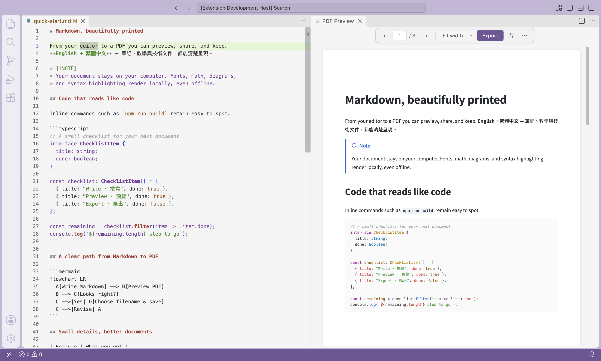
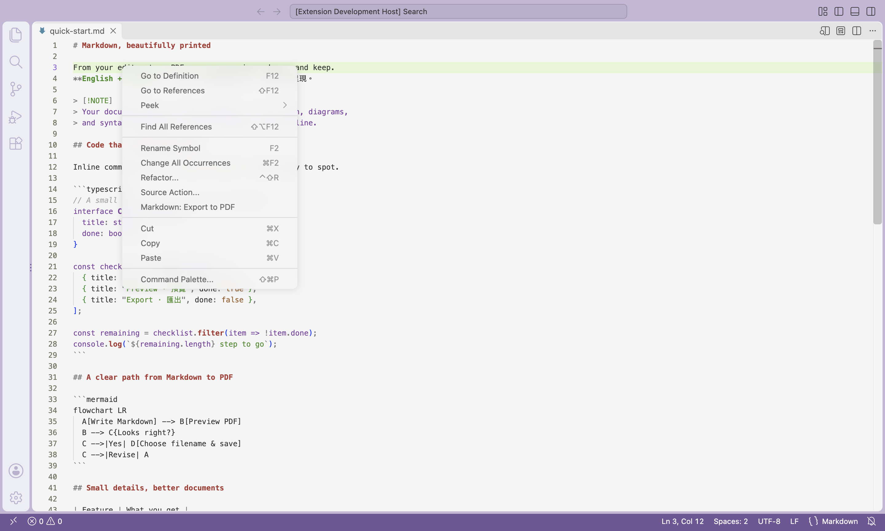
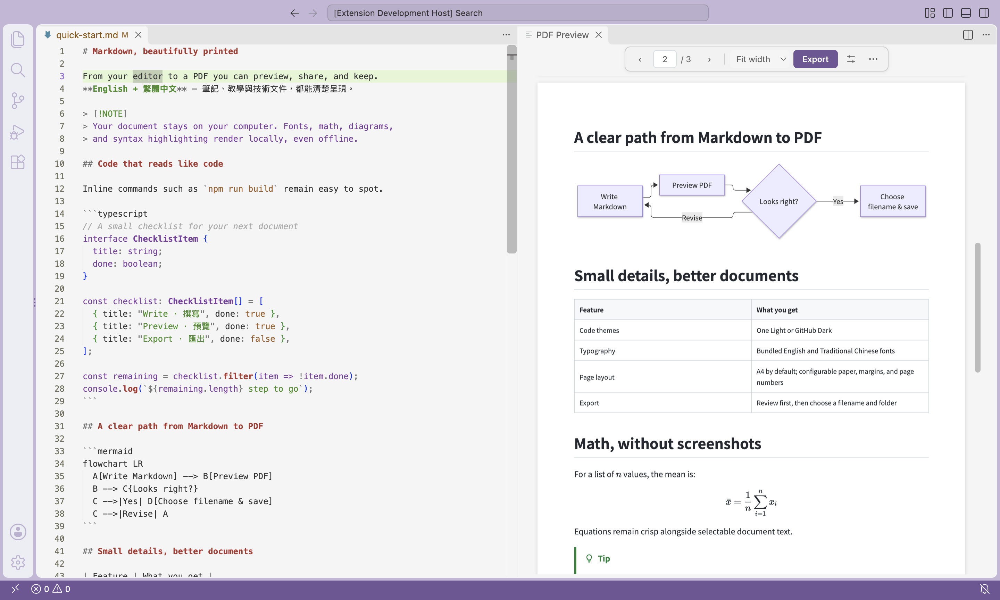

# Markdown to PDF

**VS Code 擴充套件：在本機預覽 Markdown，確認後匯出 PDF。**


[](LICENSE)

**[安裝到 VS Code](#從原始碼建置並安裝)** · [English](README.md) · [開發說明](CONTRIBUTING.md) · [驗收清單](ACCEPTANCE.md)

支援程式碼上色、數學公式、Mermaid 流程圖與中英文排版。目前以 VSIX 安裝，尚未上架 Marketplace。



## 使用方式

1. 在 Markdown 編輯器內按右鍵 → **Markdown: Export to PDF**。
2. 在 VS Code 內檢查 PDF 預覽。
3. 按 **Export**，再選擇檔名與資料夾。



截圖使用 VS Code 的 **Quiet Light** 主題，並關閉 Chat。PDF 使用獨立樣式，不受編輯器主題影響。

## 功能

- 匯出編輯器目前內容，包含尚未儲存的修改；儲存的 PDF 與預覽完全相同。
- 程式碼配色可選 **One Light**（預設）或 **GitHub Dark**。
- 支援表格、本機圖片、KaTeX 公式、Mermaid 流程圖與 GitHub 提示區塊。
- 內附字型，支援英文、繁體中文與中英混排。
- A4／A5／Letter／Legal、直橫向、字級、邊距、頁碼樣式與行內程式碼顏色可設定。
- 預覽支援縮放、符合頁寬、跳頁、文字選取與搜尋；來源修改會自動更新；設定按 Save 後才套用。
- 內附 Chromium，不需另外安裝 Chrome，也不會在第一次匯出時下載元件。

## 預覽操作

工具列依按鈕內容收合置中，PDF 捲動時保持可見。提供頁碼、縮放／符合頁寬、Export、排版設定，以及 **⋯** 內的搜尋與關閉預覽。窄視窗若隱藏前後頁按鈕，仍可直接輸入頁碼。

- 直接修改 Markdown，停止輸入約 500 ms 後重新產生預覽並保留頁碼；更新完成前無法匯出舊版本。
- 可選取、複製 PDF 文字。在預覽內按 **Cmd+F／Ctrl+F**，或從 **⋯ → Search PDF** 搜尋；**Find next** 會移至下一個符合的頁面。
- 點「⚠ 數量」查看問題原因並跳到來源區塊；一般狀態資訊收在 **⋯**，不會常駐遮住 PDF。

## 平台狀態

| 平台                            | VSIX 檔名後綴  | 驗證狀態               |
| ------------------------------- | -------------- | ---------------------- |
| macOS Apple Silicon             | `darwin-arm64` | 本機轉檔與預覽測試通過 |
| macOS Intel                     | `darwin-x64`   | 待實機驗證             |
| Windows 11 x64                  | `win32-x64`    | 待實機驗證             |
| Ubuntu 22.04 / 24.04 桌面版 x64 | `linux-x64`    | 待實機驗證             |

已提供跨平台建置流程，但不代表所有平台已完成驗收。Windows ARM、其他 Linux 發行版、VS Code 網頁版與遠端工作區不在已驗證範圍。

**Ubuntu 需要事先安裝 Chromium 系統函式庫**，VSIX 不包含這些作業系統元件。乾淨或最小安裝的 Ubuntu 可能需要管理員設定；請在斷網前依開發說明完成準備。

## 從原始碼建置並安裝

先安裝 **Git**、**Node.js 24（含 npm）** 與 **VS Code 1.95 以上版本**。請在實際使用擴充套件的作業系統與架構上建置。下載開發依賴與 Chromium 時需要網路，完成後匯出會在本機執行。

### 1. Clone 專案並安裝依賴

下載儲存庫並進入專案資料夾：

```sh
git clone https://github.com/maggie62755/markdown-to-pdf.git
cd markdown-to-pdf
npm ci
npm run prepare:browser
```

### 2. 準備 Ubuntu 系統函式庫（僅 Ubuntu）

macOS 與 Windows 請跳過此步驟。Ubuntu 請在打包前執行，過程可能需要管理員權限：

```sh
node node_modules/playwright-core/cli.js install-deps chromium
```

若將 VSIX 安裝到另一台 Ubuntu，那台電腦也須在斷網前先備妥系統函式庫。

### 3. 建置 VSIX 安裝包

```sh
npm run package
```

這個指令會自動建置程式、打包本機資源、檢查 Chromium 能否啟動，並在專案根目錄產生 VSIX。**不必另外執行 `npm run build`**；單獨執行 build 只會產生建置檔案，不會產生可安裝的 VSIX。

| 建置平台            | 產生的檔案                          |
| ------------------- | ----------------------------------- |
| macOS Apple Silicon | `markdown-to-pdf-darwin-arm64.vsix` |
| macOS Intel         | `markdown-to-pdf-darwin-x64.vsix`   |
| Windows x64         | `markdown-to-pdf-win32-x64.vsix`    |
| Ubuntu x64          | `markdown-to-pdf-linux-x64.vsix`    |

### 4. 安裝到 VS Code

若先前已安裝 **Local Markdown PDF**，請先解除安裝，再安裝 **Markdown to PDF**。套件識別碼已變更，VS Code 會視為不同擴充套件；匯出命令為 `localMarkdownPdf.export`；既有的 `localMarkdownPdf` 設定名稱繼續保留。

1. 開啟 VS Code，macOS 按 **Cmd+Shift+P**，Windows／Linux 按 **Ctrl+Shift+P**。
2. 執行 **Extensions: Install from VSIX…**。
3. 選取專案資料夾內剛產生的 `.vsix` 檔案。
4. 若 VS Code 提示重新載入視窗，請依提示操作。
5. 開啟 `fixtures/quick-start.md`，在編輯器內按右鍵 → **Markdown: Export to PDF**，即可試用預覽與匯出。

如果終端機已可使用 `code` 指令，也能直接安裝。例如 Apple Silicon Mac：

```sh
code --install-extension ./markdown-to-pdf-darwin-arm64.vsix
```

其他平台請換成表格中對應的檔名。若找不到 `code` 指令，使用上面的 VS Code 選單方式即可。之後修改原始碼時，重新執行 `npm run package`，再安裝新產生的 VSIX。

## 安裝與操作

1. 取得對應平台的 VSIX，或依上方步驟自行建置。目前尚未上架 Marketplace。
2. 在 VS Code 執行 **Extensions: Install from VSIX…**，選取安裝包。
3. 開啟本機 `.md` 檔案。未儲存修改會納入匯出；尚未命名的新文件須先儲存，以解析相對圖片路徑。
4. 編輯器內按右鍵 → **Markdown: Export to PDF**；命令面板也可使用。
5. 內容問題會在預覽中顯示佔位提示，點工具列的「⚠ 數量」可查看每個問題的原因並跳到來源區塊；Problems 面板也會保留診斷。可直接修改來源，或在匯出時選 **Export with Placeholders**。
6. 檢查預覽並按 **Export**。
7. 選擇檔名與資料夾。預設使用來源資料夾與同名 `.pdf`；選到既有檔案時由系統詢問是否取代。
8. 完成後按 **Open PDF**，以預設程式開啟。

取消預覽或儲存對話框都不會修改既有 PDF。預覽只保留目前頁與前後各一頁的 canvas 與文字層；離開畫面的頁面會釋放，回捲時重新繪製。取消儲存對話框後仍保留預覽。介面為英文，系統對話框語言依作業系統與 VS Code 設定。

## 排版與配色設定

點預覽工具列 **Export** 旁的調整圖示，開啟 **PDF Settings**。

1. 選擇儲存範圍：**User**、**Workspace**，或可用時的 **Folder**。
2. 調整欄位。每項都標示預設值；**Reset** 還原單項，**Reset all to defaults** 將表單全部還原為預設值。
3. 點顏色色塊開啟選色器，下方行內程式碼範例會顯示草稿配色；也可直接輸入六位十六進位色碼。
4. 按 **Save** 才寫入修改並更新 PDF。**Discard** 恢復已儲存的值；直接關閉設定頁不會儲存草稿。

欄位顯示來源文件目前生效的設定，Workspace／Folder 設定可能優先於 User。**VS Code settings** 按鈕會開啟原生設定頁；在原生頁修改時，依 VS Code 的一般行為立即套用。

| 設定後綴                                                    | 可用值／範圍                                                         | 預設              |
| ----------------------------------------------------------- | -------------------------------------------------------------------- | ----------------- |
| `codeTheme`                                                 | one-light、github-dark                                               | one-light         |
| `paperSize`                                                 | A4、A5、Letter、Legal                                                | A4                |
| `orientation`                                               | portrait、landscape                                                  | portrait          |
| `fontSize`                                                  | 8–24 pt（本文）                                                      | 11                |
| `marginTop` / `marginBottom` / `marginLeft` / `marginRight` | 各 5–40 mm                                                           | 22 / 24 / 18 / 18 |
| `pageNumbers`                                               | true / false                                                         | true              |
| `pageNumberStyle`                                           | current-total（1 / 10）、current（1）、page-of-total（Page 1 of 10） | current-total     |
| `inlineCodeBackground`                                      | 六位十六進位顏色                                                     | #f1f3f5           |
| `inlineCodeColor`                                           | 六位十六進位顏色                                                     | #172b4d           |

完整名稱例如 `localMarkdownPdf.paperSize`。行內程式碼顏色適用於單反引號的 `code`；多行程式碼區塊使用 `codeTheme`。搜尋的 **Find next** 會移至下一個含有關鍵字的頁面，並標記該頁相符文字。

只保留 **Markdown: Export to PDF** 指令；舊的 `localMarkdownPdf.exportAs` 已移除，自訂快捷鍵請改用 `localMarkdownPdf.export`。

## 支援的內容

支援一般 Markdown 語法；公式使用 `$…$`／`$$…$$`，流程圖使用 `mermaid` 程式碼區塊。

```markdown
> [!NOTE]
> 補充說明，可以包含 **粗體** 與 `行內程式碼`。

> [!IMPORTANT]
> 請先檢查預覽，再確認匯出。
```

支援 `NOTE`、`TIP`、`IMPORTANT`、`WARNING`、`CAUTION`；標記須獨占最外層引用區塊的第一行。巢狀或未知標記保留一般引用樣式。`fixtures/` 提供完整範例與邊界案例。



## 離線與限制

VSIX 包含 Chromium、PDF.js、Shiki、KaTeX、Mermaid、樣式與字型。渲染器阻擋外部請求與文件任意腳本；內嵌 HTML 僅接受少量無屬性的文字標籤。

- 圖片支援 PNG、JPEG、GIF、WebP，以 Markdown 所在目錄解析相對路徑。遠端圖片須自行下載並修改引用；SVG 圖檔須先轉成 PNG，Mermaid 產生的 SVG 則可使用。
- 圖片缺失、公式或流程圖錯誤會在預覽中留下可辨識提示，匯出時須明確確認保留佔位提示。部分來源位置只能定位到區塊起始行。
- 超大型流程圖、過寬公式、過高表格列、罕見字與 emoji 仍需檢查。
- PDF 閱讀器複製已換行的 Bash 指令時，可能加入換行字元，執行前請確認。
- 停止輸入約 500 ms 後開始更新預覽，轉檔仍需要時間；更新期間無法匯出舊版本，更新後保留閱讀頁碼。首次啟動 Chromium 可能需要數秒。

## 開發與授權

安裝依賴、格式化、測試、截圖重拍及各平台打包方式見 [CONTRIBUTING.md](CONTRIBUTING.md)。GitHub Actions 的 **Check** 會在 PR 與推送至 `main` 時執行基本與整合檢查；手動 **Package** 工作流程會上傳 VSIX 與範例 PDF，並不會自動發佈 Release 或 Marketplace。

採用 [MIT 授權](LICENSE)；字型保留 OFL 授權，建置產物包含第三方授權聲明。
