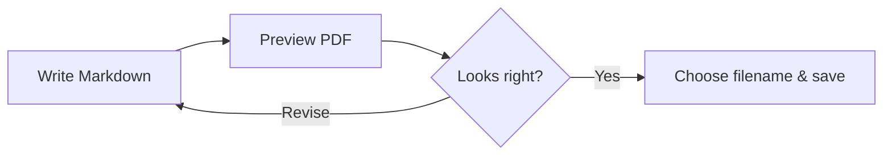

# Markdown, beautifully printed

From your editor to a PDF you can preview, share, and keep.
**English + 繁體中文** — 筆記、教學與技術文件，都能清楚呈現。

> [!NOTE]
> Your document stays on your computer. Fonts, math, diagrams,
> and syntax highlighting render locally, even offline.

## Code that reads like code

Inline commands such as `npm run build` remain easy to spot.

```typescript
// A small checklist for your next document
interface ChecklistItem {
  title: string;
  done: boolean;
}

const checklist: ChecklistItem[] = [
  { title: "Write · 撰寫", done: true },
  { title: "Preview · 預覽", done: true },
  { title: "Export · 匯出", done: false },
];

const remaining = checklist.filter(item => !item.done);
console.log(`${remaining.length} step to go`);
```

## A clear path from Markdown to PDF



## Small details, better documents

| Feature | What you get |
| :--- | :--- |
| Code themes | One Light or GitHub Dark |
| Typography | Bundled English and Traditional Chinese fonts |
| Page layout | A4 margins, page numbers, and wrapped code |
| Export | Review first, then choose a filename and folder |

## Math, without screenshots

For a list of $n$ values, the mean is:

$$
\bar{x} = \frac{1}{n}\sum_{i=1}^{n} x_i
$$

Equations remain crisp alongside selectable document text.

> [!TIP]
> Switch `localMarkdownPdf.codeTheme` to `github-dark`
> for dark code blocks while keeping the page white.

> [!IMPORTANT]
> Confirm the preview before saving. Cancelling leaves your
> existing PDF untouched.
