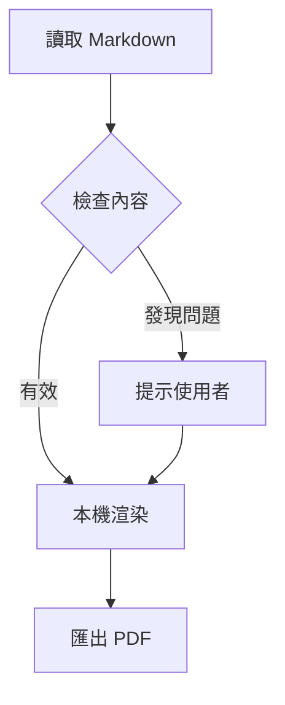

# Markdown → PDF 驗收文件

這份文件包含繁體中文與 English mixed text。測試「標點符號」、**粗體文字**、*斜體*、~~刪除線~~、`inline code` 與 [連結](https://example.com)。

> 文件樣式固定為白底，與 VS Code 主題無關。

## 清單與程式碼

1. 安裝擴充套件。
2. 開啟 Markdown 文件。
   - 支援尚未儲存的修改。
   - 匯出後檢查複製效果。

```bash
#!/usr/bin/env bash
set -euo pipefail
name="繁體中文測試"
printf '%s\n' "$name"
curl --request POST --header 'Content-Type: application/json' --data '{"message":"This intentionally long shell command should wrap while preserving every character and indentation in the exported PDF document."}' https://example.com/api
```

```typescript
const greeting: string = 'Hello，世界';
console.log(greeting);
```

```python
for number in range(3):
    print(f"項目 {number}")
```

```javascript
const numbers = [1, 2, 3].map(n => n * 2);
```

```json
{"language":"繁體中文","offline":true}
```

```unknown
未辨識語言仍會保留原文 <tag> & content
```

## 數學公式

行內公式 $E=mc^2$ 與 $a^2+b^2=c^2$。

$$
\int_0^1 x^2\,dx = \frac{1}{3}
$$

## Mermaid 流程圖



## 本機圖片


## 表格

| 項目 | 說明 | 狀態 |
| --- | --- | --- |
| 中文字型 | 本機 Noto Sans TC | 完成 |
| 程式碼 | 本機語法上色 | 完成 |
| 圖片 | 中文與空白路徑 | 完成 |

---

## 長程式碼與跨頁表格

```bash
printf "%s\n" "第 001 行：跨頁保留內容"
printf "%s\n" "第 002 行：跨頁保留內容"
printf "%s\n" "第 003 行：跨頁保留內容"
printf "%s\n" "第 004 行：跨頁保留內容"
printf "%s\n" "第 005 行：跨頁保留內容"
printf "%s\n" "第 006 行：跨頁保留內容"
printf "%s\n" "第 007 行：跨頁保留內容"
printf "%s\n" "第 008 行：跨頁保留內容"
printf "%s\n" "第 009 行：跨頁保留內容"
printf "%s\n" "第 010 行：跨頁保留內容"
printf "%s\n" "第 011 行：跨頁保留內容"
printf "%s\n" "第 012 行：跨頁保留內容"
printf "%s\n" "第 013 行：跨頁保留內容"
printf "%s\n" "第 014 行：跨頁保留內容"
printf "%s\n" "第 015 行：跨頁保留內容"
printf "%s\n" "第 016 行：跨頁保留內容"
printf "%s\n" "第 017 行：跨頁保留內容"
printf "%s\n" "第 018 行：跨頁保留內容"
printf "%s\n" "第 019 行：跨頁保留內容"
printf "%s\n" "第 020 行：跨頁保留內容"
printf "%s\n" "第 021 行：跨頁保留內容"
printf "%s\n" "第 022 行：跨頁保留內容"
printf "%s\n" "第 023 行：跨頁保留內容"
printf "%s\n" "第 024 行：跨頁保留內容"
printf "%s\n" "第 025 行：跨頁保留內容"
printf "%s\n" "第 026 行：跨頁保留內容"
printf "%s\n" "第 027 行：跨頁保留內容"
printf "%s\n" "第 028 行：跨頁保留內容"
printf "%s\n" "第 029 行：跨頁保留內容"
printf "%s\n" "第 030 行：跨頁保留內容"
printf "%s\n" "第 031 行：跨頁保留內容"
printf "%s\n" "第 032 行：跨頁保留內容"
printf "%s\n" "第 033 行：跨頁保留內容"
printf "%s\n" "第 034 行：跨頁保留內容"
printf "%s\n" "第 035 行：跨頁保留內容"
printf "%s\n" "第 036 行：跨頁保留內容"
printf "%s\n" "第 037 行：跨頁保留內容"
printf "%s\n" "第 038 行：跨頁保留內容"
printf "%s\n" "第 039 行：跨頁保留內容"
printf "%s\n" "第 040 行：跨頁保留內容"
printf "%s\n" "第 041 行：跨頁保留內容"
printf "%s\n" "第 042 行：跨頁保留內容"
printf "%s\n" "第 043 行：跨頁保留內容"
printf "%s\n" "第 044 行：跨頁保留內容"
printf "%s\n" "第 045 行：跨頁保留內容"
printf "%s\n" "第 046 行：跨頁保留內容"
printf "%s\n" "第 047 行：跨頁保留內容"
printf "%s\n" "第 048 行：跨頁保留內容"
printf "%s\n" "第 049 行：跨頁保留內容"
printf "%s\n" "第 050 行：跨頁保留內容"
printf "%s\n" "第 051 行：跨頁保留內容"
printf "%s\n" "第 052 行：跨頁保留內容"
printf "%s\n" "第 053 行：跨頁保留內容"
printf "%s\n" "第 054 行：跨頁保留內容"
printf "%s\n" "第 055 行：跨頁保留內容"
printf "%s\n" "第 056 行：跨頁保留內容"
printf "%s\n" "第 057 行：跨頁保留內容"
printf "%s\n" "第 058 行：跨頁保留內容"
printf "%s\n" "第 059 行：跨頁保留內容"
printf "%s\n" "第 060 行：跨頁保留內容"
printf "%s\n" "第 061 行：跨頁保留內容"
printf "%s\n" "第 062 行：跨頁保留內容"
printf "%s\n" "第 063 行：跨頁保留內容"
printf "%s\n" "第 064 行：跨頁保留內容"
printf "%s\n" "第 065 行：跨頁保留內容"
printf "%s\n" "第 066 行：跨頁保留內容"
printf "%s\n" "第 067 行：跨頁保留內容"
printf "%s\n" "第 068 行：跨頁保留內容"
printf "%s\n" "第 069 行：跨頁保留內容"
printf "%s\n" "第 070 行：跨頁保留內容"
printf "%s\n" "第 071 行：跨頁保留內容"
printf "%s\n" "第 072 行：跨頁保留內容"
printf "%s\n" "第 073 行：跨頁保留內容"
printf "%s\n" "第 074 行：跨頁保留內容"
printf "%s\n" "第 075 行：跨頁保留內容"
printf "%s\n" "第 076 行：跨頁保留內容"
printf "%s\n" "第 077 行：跨頁保留內容"
printf "%s\n" "第 078 行：跨頁保留內容"
printf "%s\n" "第 079 行：跨頁保留內容"
printf "%s\n" "第 080 行：跨頁保留內容"
```

| 編號 | 說明 | 很長的識別字 |
| --- | --- | --- |
| 1 | 跨頁表格第 1 筆資料 | abcdefghijklmnopqrstuvwxyz0123456789 |
| 2 | 跨頁表格第 2 筆資料 | abcdefghijklmnopqrstuvwxyz0123456789 |
| 3 | 跨頁表格第 3 筆資料 | abcdefghijklmnopqrstuvwxyz0123456789 |
| 4 | 跨頁表格第 4 筆資料 | abcdefghijklmnopqrstuvwxyz0123456789 |
| 5 | 跨頁表格第 5 筆資料 | abcdefghijklmnopqrstuvwxyz0123456789 |
| 6 | 跨頁表格第 6 筆資料 | abcdefghijklmnopqrstuvwxyz0123456789 |
| 7 | 跨頁表格第 7 筆資料 | abcdefghijklmnopqrstuvwxyz0123456789 |
| 8 | 跨頁表格第 8 筆資料 | abcdefghijklmnopqrstuvwxyz0123456789 |
| 9 | 跨頁表格第 9 筆資料 | abcdefghijklmnopqrstuvwxyz0123456789 |
| 10 | 跨頁表格第 10 筆資料 | abcdefghijklmnopqrstuvwxyz0123456789 |
| 11 | 跨頁表格第 11 筆資料 | abcdefghijklmnopqrstuvwxyz0123456789 |
| 12 | 跨頁表格第 12 筆資料 | abcdefghijklmnopqrstuvwxyz0123456789 |
| 13 | 跨頁表格第 13 筆資料 | abcdefghijklmnopqrstuvwxyz0123456789 |
| 14 | 跨頁表格第 14 筆資料 | abcdefghijklmnopqrstuvwxyz0123456789 |
| 15 | 跨頁表格第 15 筆資料 | abcdefghijklmnopqrstuvwxyz0123456789 |
| 16 | 跨頁表格第 16 筆資料 | abcdefghijklmnopqrstuvwxyz0123456789 |
| 17 | 跨頁表格第 17 筆資料 | abcdefghijklmnopqrstuvwxyz0123456789 |
| 18 | 跨頁表格第 18 筆資料 | abcdefghijklmnopqrstuvwxyz0123456789 |
| 19 | 跨頁表格第 19 筆資料 | abcdefghijklmnopqrstuvwxyz0123456789 |
| 20 | 跨頁表格第 20 筆資料 | abcdefghijklmnopqrstuvwxyz0123456789 |
| 21 | 跨頁表格第 21 筆資料 | abcdefghijklmnopqrstuvwxyz0123456789 |
| 22 | 跨頁表格第 22 筆資料 | abcdefghijklmnopqrstuvwxyz0123456789 |
| 23 | 跨頁表格第 23 筆資料 | abcdefghijklmnopqrstuvwxyz0123456789 |
| 24 | 跨頁表格第 24 筆資料 | abcdefghijklmnopqrstuvwxyz0123456789 |
| 25 | 跨頁表格第 25 筆資料 | abcdefghijklmnopqrstuvwxyz0123456789 |
| 26 | 跨頁表格第 26 筆資料 | abcdefghijklmnopqrstuvwxyz0123456789 |
| 27 | 跨頁表格第 27 筆資料 | abcdefghijklmnopqrstuvwxyz0123456789 |
| 28 | 跨頁表格第 28 筆資料 | abcdefghijklmnopqrstuvwxyz0123456789 |
| 29 | 跨頁表格第 29 筆資料 | abcdefghijklmnopqrstuvwxyz0123456789 |
| 30 | 跨頁表格第 30 筆資料 | abcdefghijklmnopqrstuvwxyz0123456789 |
| 31 | 跨頁表格第 31 筆資料 | abcdefghijklmnopqrstuvwxyz0123456789 |
| 32 | 跨頁表格第 32 筆資料 | abcdefghijklmnopqrstuvwxyz0123456789 |
| 33 | 跨頁表格第 33 筆資料 | abcdefghijklmnopqrstuvwxyz0123456789 |
| 34 | 跨頁表格第 34 筆資料 | abcdefghijklmnopqrstuvwxyz0123456789 |
| 35 | 跨頁表格第 35 筆資料 | abcdefghijklmnopqrstuvwxyz0123456789 |
| 36 | 跨頁表格第 36 筆資料 | abcdefghijklmnopqrstuvwxyz0123456789 |
| 37 | 跨頁表格第 37 筆資料 | abcdefghijklmnopqrstuvwxyz0123456789 |
| 38 | 跨頁表格第 38 筆資料 | abcdefghijklmnopqrstuvwxyz0123456789 |
| 39 | 跨頁表格第 39 筆資料 | abcdefghijklmnopqrstuvwxyz0123456789 |
| 40 | 跨頁表格第 40 筆資料 | abcdefghijklmnopqrstuvwxyz0123456789 |
| 41 | 跨頁表格第 41 筆資料 | abcdefghijklmnopqrstuvwxyz0123456789 |
| 42 | 跨頁表格第 42 筆資料 | abcdefghijklmnopqrstuvwxyz0123456789 |
| 43 | 跨頁表格第 43 筆資料 | abcdefghijklmnopqrstuvwxyz0123456789 |
| 44 | 跨頁表格第 44 筆資料 | abcdefghijklmnopqrstuvwxyz0123456789 |
| 45 | 跨頁表格第 45 筆資料 | abcdefghijklmnopqrstuvwxyz0123456789 |
| 46 | 跨頁表格第 46 筆資料 | abcdefghijklmnopqrstuvwxyz0123456789 |
| 47 | 跨頁表格第 47 筆資料 | abcdefghijklmnopqrstuvwxyz0123456789 |
| 48 | 跨頁表格第 48 筆資料 | abcdefghijklmnopqrstuvwxyz0123456789 |
| 49 | 跨頁表格第 49 筆資料 | abcdefghijklmnopqrstuvwxyz0123456789 |
| 50 | 跨頁表格第 50 筆資料 | abcdefghijklmnopqrstuvwxyz0123456789 |
| 51 | 跨頁表格第 51 筆資料 | abcdefghijklmnopqrstuvwxyz0123456789 |
| 52 | 跨頁表格第 52 筆資料 | abcdefghijklmnopqrstuvwxyz0123456789 |
| 53 | 跨頁表格第 53 筆資料 | abcdefghijklmnopqrstuvwxyz0123456789 |
| 54 | 跨頁表格第 54 筆資料 | abcdefghijklmnopqrstuvwxyz0123456789 |
| 55 | 跨頁表格第 55 筆資料 | abcdefghijklmnopqrstuvwxyz0123456789 |
| 56 | 跨頁表格第 56 筆資料 | abcdefghijklmnopqrstuvwxyz0123456789 |
| 57 | 跨頁表格第 57 筆資料 | abcdefghijklmnopqrstuvwxyz0123456789 |
| 58 | 跨頁表格第 58 筆資料 | abcdefghijklmnopqrstuvwxyz0123456789 |
| 59 | 跨頁表格第 59 筆資料 | abcdefghijklmnopqrstuvwxyz0123456789 |
| 60 | 跨頁表格第 60 筆資料 | abcdefghijklmnopqrstuvwxyz0123456789 |
